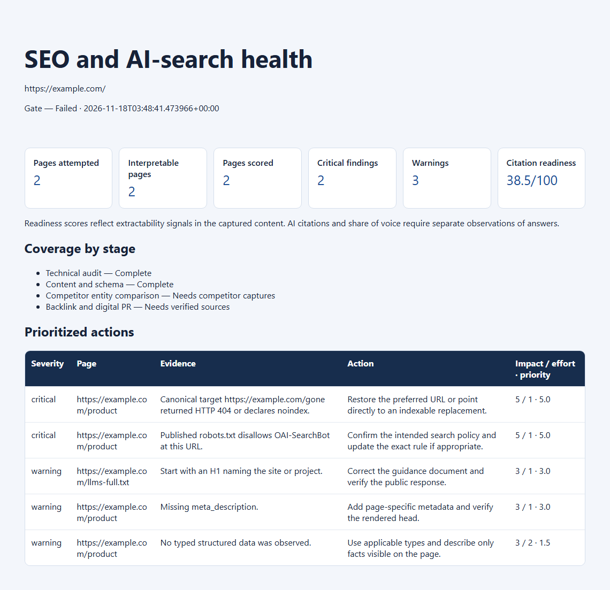

<div align="center">
  
  <h1>Make your website easier to find and cite</h1>
  <p>Audit JavaScript websites, find search and content gaps, and turn the evidence into fixes you can review.</p>
  <p>
    <a href="https://github.com/sraban566/automate-SEO/releases/latest"></a>
    <a href="https://github.com/sraban566/automate-SEO/actions/workflows/tests.yml"></a>
    <a href="LICENSE"></a>
    <a href="#quick-start"></a>
  </p>
  <p>
    <a href="#quick-start">Install</a> &nbsp;·&nbsp;
    <a href="#what-you-get">See what it does</a> &nbsp;·&nbsp;
    <a href="#copy-a-prompt">Copy a prompt</a> &nbsp;·&nbsp;
    <a href="#automate-audits-in-github">Set up GitHub Actions</a>
  </p>
</div>

**automate-SEO** is an open-source toolkit for technical SEO, answer engine optimization (AEO), and generative engine optimization (GEO). Use it from a terminal or with a coding assistant. The crawler runs locally and needs no paid API key.

## Quick start

### Use it with your assistant

Download the [latest skill ZIP](https://github.com/sraban566/automate-SEO/releases/latest/download/automate-seo-skill.zip) for hosts that support skill uploads, or install it from a checkout. Follow the guide for [Codex](docs/agent-installation.md#codex), [Claude Code](docs/agent-installation.md#claude-code), or [Cursor](docs/agent-installation.md#cursor). Run the diagnostic in the assistant's actual execution environment.

```text
Install automate-SEO from https://github.com/sraban566/automate-SEO.
Follow docs/agent-installation.md for this host and run doctor.
Then audit https://example.com and summarize the most important findings.
```

<details open>
<summary><strong>Run it from your terminal</strong></summary>

Use Python 3.10 or newer. Create and activate a virtual environment. On Windows PowerShell, activate it with `.venv\Scripts\Activate.ps1`.

```sh
git clone https://github.com/sraban566/automate-SEO.git
cd automate-SEO
python -m venv .venv
source .venv/bin/activate
python -m pip install -e ".[browser]"
python -m playwright install chromium
automate-seo doctor
automate-seo health --url https://example.com --mode auto --out runs/example
```

With uv, run `uv sync --extra browser`, `uv run playwright install chromium`, then prefix the audit command with `uv run`. Open `runs/example/health.html` to review the report. Use a fresh output directory for each live audit.

</details>

<details>
<summary><strong>Run the GitHub container package</strong></summary>

```sh
docker run --rm ghcr.io/sraban566/automate-seo:4.0.1 doctor
```

The image includes Chromium and the PDF renderer. For an audit, mount a writable directory or a named volume at `/work` to keep the reports after the container exits.

```sh
docker run --rm -v automate-seo-reports:/work ghcr.io/sraban566/automate-seo:4.0.1 \
  health --url https://example.com --mode auto --out /work/example
```

</details>

## What you get

| Find issues | Improve what search engines can read | Check evidence and fixes |
| --- | --- | --- |
| Inspect status codes, canonicals, metadata, crawler rules, rendered HTML and structured data. | Validate nested JSON-LD entity graphs, score citation readiness, and draft `llms.txt` and `llms-full.txt` from captured pages. | Compare entities from competitor crawls, verify a sample of backlink leads, and stage reviewed metadata and schema changes as Git diffs. |

Every health run exports a standalone HTML dashboard, Markdown, and structured JSON. Findings include the affected URL, evidence, estimated impact and effort, and a next action.

<p align="center">
  
</p>

*Example dashboard generated from a local test fixture.*

## Copy a prompt

<details open>
<summary><strong>Find the most important SEO fixes</strong></summary>

```text
Run automate-seo health on https://example.com. Render JavaScript if needed.
Give me the top three issues, the URLs and capture evidence, and how to verify each fix.
```

</details>

<details>
<summary><strong>Make a page easier for answer engines to use</strong></summary>

```text
Use the saved audit to check the homepage's JSON-LD and citation readiness.
Draft a direct answer to the customer question and flag claims that need a primary source.
Prepare llms.txt and llms-full.txt from the reviewed capture and validate both drafts.
```

</details>

<details>
<summary><strong>Review a metadata or schema change</strong></summary>

```text
Use automate-seo agent schema-fix with these approved values.
Show the Git diff for the relevant HTML, Next.js or React file and the verification steps.
```

</details>

## How it works

The Python crawler collects robots, sitemap and link evidence in a resumable SQLite queue. HTTP workers fetch pages, and optional Chromium captures JavaScript content under the same request and robots constraints. Four stages interpret the evidence for technical findings, content and schema, competitor entity gaps, and backlink and digital PR opportunities. Citation readiness measures extractability from the capture. Actual citations and share of voice require observations of answers in the relevant engines. [Architecture](docs/architecture.md) · [Evidence and measurement](references/measurement-boundaries.md)

### Useful commands

| Command | What it does |
| --- | --- |
| `automate-seo health --crawl runs/example/crawl --out runs/review` | Replay captured evidence offline. |
| `automate-seo entity-review --crawl runs/example/crawl --out runs/entities` | Inspect identity and schema evidence across pages. |
| `automate-seo llms generate --crawl runs/example/crawl --out runs/llms` | Draft and validate AI guidance files. |
| `automate-seo llms validate runs/llms/llms.txt --url https://example.com/llms.txt` | Validate a guidance file and its link syntax. |
| `automate-seo agent tools.list` | List the audit, schema-fix and content-brief tools. |
| `automate-seo rpc` | Serve the same tools over newline-delimited JSON-RPC. |

To review a competitor, pass `--competitor-crawl` for each capture. Use `--research-queries queries.json --brand "Your Brand"` to discover leads and verify a bounded sample, or import `--reputation` evidence. [Discovery guide](docs/discovery-and-competitors.md) · [Backlink catalog](docs/backlink-source-catalog.md)

<details>
<summary><strong>Agent API and reviewed Git patches</strong></summary>

Pass a JSON file of named arguments to `automate-seo agent <tool> --input params.json`, or send this line to the `rpc` subprocess.

```json
{"jsonrpc":"2.0","id":1,"method":"audit","params":{"crawl_dir":"runs/example/crawl"}}
```

`schema-fix` takes a Git root, tracked source file, approved `changes` and optional `framework`. The HTML helper updates scoped head metadata. For Next.js App Router metadata, place a standalone `// automate-seo:metadata` at module scope. For React 19, put `{/* automate-seo:metadata */}` in the relevant component. For JSON-LD, use `{/* automate-seo:schema */}` in the intended component. Existing schema needs a deliberate merge. [Website work](docs/website-work.md)

</details>

## Automate audits in GitHub

The [SEO workflow](https://github.com/sraban566/automate-SEO/blob/main/.github/workflows/seo-audit.yml) runs on pushes to `main`, on a weekly schedule and by manual dispatch. Set the repository variable `SEO_AUDIT_URLS` to one public URL per line, up to ten. The workflow uses Chromium with first-party assets and uploads the three report formats even when the gate fails.

`SEO_FAIL_ON` accepts `critical`, `warning` and `none` for report-only mode. Zero scorable pages raises a critical coverage finding and fails either active gate. Save a reviewed baseline at `.github/seo-baselines/target-1.json` to report new or escalated findings at the chosen threshold. [Full documentation](docs/README.md)

## Development

```sh
python -m pip install -e ".[browser,dev,hosting-test]"
python -m playwright install chromium
ruff check .
ruff format --check .
python -m unittest discover -s tests -v
python scripts/check_docs.py
python scripts/validate_skill.py
```

Python library imports use `automate_seo`. Version 4 moves the public module namespace to match the project. [Changelog](CHANGELOG.md) · [Contributing](CONTRIBUTING.md)

MIT licensed. Original project attribution is recorded in [LICENSE](LICENSE) and [NOTICE](NOTICE).
